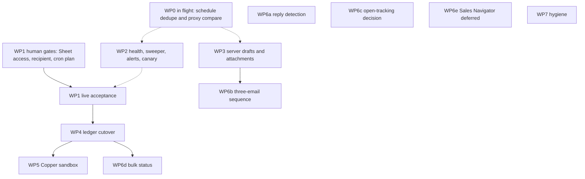

# Implementation plan

This is the plan Hermes coding agents follow for the remaining work on `roryatelier/atelier-sales-tool`. GitHub Issues are disabled. When a slice lands, update the status table in this file. Do not copy prospect names, private addresses, dossier text, spreadsheet ids, message ids, secrets, or private URLs into this file, a pull request, or a commit message. The repository is public.

Baseline: `main` at `71c2c44` (pull request #19, "scheduling idempotency, Gmail id preservation, attachment guard, dossier XSS"). Read `AGENTS.md`, `doc/ROADMAP.md`, `doc/SHEETS_EXPORTS.md`, and the code before editing. `doc/ROADMAP.md` was last fully reconciled on 19–20 October 2026 and is historical where it disagrees with this file.

## Status

Agents update this table when a slice merges. Status is `not started`, `in progress`, `blocked`, or `done`. The PR column is a pull request number, or `—`. Notes stay free of private data: write "passed", "failed", or a short technical result.

| ID | Work | Status | PR | Notes |
|---|---|---|---|---|
| WP0 | In flight, not this plan: second-tab schedule dedupe, constant-time `CRON_SECRET` compare in `proxy.ts` | in flight | — | Not on `71c2c44`. Do not redo. See below. |
| WP1 | Production acceptance test | not started | — | Blocked on human gates (Sheet access, approved recipient, Vercel cron plan). |
| WP2 | Monitoring and release checks | in progress | #20–#22 | Health, sweeper, and queue alerts merged and deployed; post-deploy canary check still open. |
| WP3 | Durable server-owned drafts | in progress | #26 | Slice 1 (owner-scoped server drafts) in review; slices 2–5 not started. |
| WP4 | Pipeline ledger migration | not started | — | Cutover waits for WP1. |
| WP5 | Copper CRM pilot | not started | — | Blocked on WP4 and a field-mapping agreement. |
| WP6a | Automatic reply detection | not started | — | Human gate: Gmail read scope and re-consent. |
| WP6b | One-click 3-email sequence | not started | — | Blocked on WP3. |
| WP6c | Email open tracking | not started | — | Human decision. Default is do not build. |
| WP6d | Bulk pipeline status update | not started | — | Blocked on WP4. |
| WP6e | Sales Navigator | deferred | — | Human gate: LinkedIn Team account. |
| WP7a | "Limited ANZ data" banner copy | done | #24 | Merged and deployed; source-level test added. |
| WP7b | Stale docs listed in the roadmap | done | #25 | Merged and deployed; provider-policy passed. |
| WP7c | Branch ruleset: required `verify` plus code-owner review | not started | — | Human/admin. A pull request cannot close this. |
| WP7d | Point `doc/ROADMAP.md` and `AGENTS.md` at this plan | done | — | Landed in the pull request that added this file. |

## Already released

Summarised from `main` at `71c2c44`. Do not rebuild these.

- **Brand Search restore (#4).** Previously researched dossiers are listed with saved suggestions and opened without paying for research again.
- **Role-based templates (#5, #6, #7).** Company template library, role-group mapping, selection order, and follow-up context. User edits survive the seed. Tests: `tests/email-content.cjs`.
- **Source template shown (#8).** Draft generation displays the selected template and role group.
- **Sender signatures (#10, #18).** Each sender can save a signature. Immediate and scheduled sends share the HTML/MIME builder. The editor distinguishes empty, unchanged, edited, and clearing (`lib/email-signature.ts`).
- **Per-draft instructions and guidance provenance (#11, #12).** Instructions are kept per browser tab. Seeded, explicitly saved, and legacy guidance are distinct. Prompt precedence is a model instruction, not a runtime guarantee.
- **Safe immediate sending (#13).** `send_records` is durable and payload-bound. Claims are atomic. Accepted, failed, and review outcomes replay without another Gmail call. The composer stores the confirmation before the request, restores it per tab, and shares identities across browser documents in IndexedDB (`lib/send-confirmation-store.ts`). Ambiguous outcomes stay `needs_review` and are not resent.
- **Scheduled-send recovery (#16).** The worker claims only `pending`. Interrupted preparation can return to pending; a send attempt that is interrupted becomes `needs_review` and is not retried. Legacy rows stay `legacy_quarantined`. Cancellation fences the job before send intent. Only the owner can resume a pre-intent `needs_reauth` job, with the same recipient, message, and time.
- **Durable Sheets export outbox (#17).** Gmail acceptance and an `outreach_exports` event commit together via database triggers. Export retries never call Gmail. Uncertain writes reconcile by outreach id and do not append again. Runbook: `doc/SHEETS_EXPORTS.md`. Sheet1 columns R:S are not reserved in production until WP1.
- **Scheduling idempotency, Gmail id preservation, attachment guard, dossier XSS (#19).** A schedule `request_id` replays the same job and rejects a changed payload. A Gmail message id that arrives before the acceptance write is stored, so review cannot turn into a hand resend. Scheduling with attachments is refused in the composer and in `app/api/schedule-email/route.ts`. Dossier bullets are HTML-escaped in `lib/dossier-bullet.ts` before the bold markup is applied.

CI `verify` does not call live Gmail, Sheets, Lusha, OpenAI, Neon, or Copper. Mocked tests are not evidence of live delivery.

## In flight (WP0)

No open pull request was on the repository when this plan was written. Treat the two fixes below as in flight if a pull request for them is open, or if one lands while this plan is underway. Do not reimplement them inside WP1–WP7. If that pull request touches a file you also need, rebase onto it.

**Second-tab schedule dedupe.** `handleSchedule` in `app/email/page.tsx` stores the schedule `request_id` in `sessionStorage` (`atelier_schedule_request_` plus a fingerprint). `sessionStorage` is per tab, so a second tab mints a new id. The server unique key is `scheduled_emails.request_id` (partial unique index, added in #19), not the payload hash, so the second id inserts a second job. The comment in the composer says the id survives second tabs. It does not. The expected fix stores the id in owner-scoped browser storage (`lib/browser-storage.ts`), not a raw key that survives an account change. Do not add a server-side unique constraint on the payload as a drive-by. Identical copy sent later, or to a different recipient, must still be allowed when the user confirms a new id.

**Constant-time cron secret compare in `proxy.ts`.** `app/api/cron/send-scheduled-emails/route.ts` already compares the bearer token with `timingSafeEqual` and rejects a missing secret. `proxy.ts` still uses `!==` on `Authorization` before the route runs. The expected fix makes that proxy compare constant-time and still fails closed when `CRON_SECRET` is unset. `proxy.ts` is an ask-first file. WP2's health exception must be rebased onto this fix if both edit `proxy.ts`.

## How agents should read the code

| Concern | Where it lives now |
|---|---|
| Auth boundary | `proxy.ts`. OAuth start and callback are the public exceptions. Cron requires `CRON_SECRET`. Everything else needs a session. Mutations need an exact `Origin`. |
| Immediate send | `app/api/send-email/route.ts`, `lib/gmail.ts`, `lib/send-confirmation.ts`. Statuses: `recorded`, `sending`, `accepted`, `failed_auth`, `failed`, `needs_review`. Acceptance requires a nonempty Gmail message id. |
| Schedule | `app/api/schedule-email/route.ts`, `lib/scheduled-email-store.ts`, `app/api/cron/send-scheduled-emails/route.ts`. Worker selects `pending` only. `vercel.json` cron is `*/15 * * * *`. Function max duration is 90 seconds. The cron also drains one export per run. |
| Sheets outbox | `lib/outreach-outbox.ts`, `lib/sheets.ts`, `app/api/pipeline-exports/route.ts`. Statuses: `pending`, `claimed`, `writing`, `synced`, `failed`, `needs_review`. |
| Pipeline read | `app/api/pipeline/route.ts` reads `Sheet1!A:S` for every admitted user. It does not read the database. |
| Legacy sheet writes | `app/api/save-to-sheets/route.ts` appends `A:Q` with no outreach id. `app/api/update-pipeline/route.ts` and `app/api/update-notes/route.ts` edit by outreach id when one exists, otherwise by a single brand-name match and a row position. |
| Contact history | `contact_history` has no owner column. `app/api/contact-history/route.ts` reads and writes by brand name for any admitted user. Sends insert a row from `app/api/send-email/route.ts` and the cron. |
| Drafts | Owner-scoped `localStorage` (`lib/browser-storage.ts`) and IndexedDB confirmations. Attachment bytes stay in the browser. There is no server draft id. |
| Gmail scope | `app/api/auth/gmail/route.ts` requests `gmail.send` plus userinfo email and profile. It does not request a read scope. `sendViaGmail` returns a thread id. Immediate sends do not store it. Scheduled sends store `gmail_thread_id`. |
| Schema | Inline `CREATE` / `ALTER` in `lib/db.ts`. Postgres and SQLite are separate branches. There is no migrations directory. |
| Release checks | `.github/workflows/ci.yml` runs `npm run verify:ci` only. No post-deploy workflow. `config/deployment.json` names the Vercel project. |

Product invariants, from `AGENTS.md`, apply to every package:

- Authenticate before any provider or database work. Missing security configuration fails closed.
- No email without an explicit confirmation. The request's `to` is the recipient. Never substitute a stored address.
- Scheduled, claimed, or Gmail-accepted is not proof the recipient read or received the message. Acceptance means a nonempty message id.
- Retrying Sheets or any future CRM sync never sends the email again. Ambiguous Gmail outcomes are reviewed, not automatically retried.
- `legacy_quarantined` rows stay quarantined. Do not auto-send or auto-activate them.
- Do not automatically retry a paid Lusha reveal.
- No prospect or mailbox data in fixtures, snapshots, pull requests, or this file.

Ask-first paths (Rory's review, do not self-merge): `proxy.ts`, auth and session modules, `lib/browser-storage.ts`, Gmail send and schedule routes, `app/api/cron/`, Lusha, `lib/db.ts`, `config/`, `vercel.json`, `scripts/check-*.mjs`, `.github/**`, `package.json`, and `package-lock.json`. Also ask before changing what a prospect is sent, re-enabling a quarantined send, deleting stored data, or increasing provider spend.

---

## WP1 — Production acceptance test

**Size:** M. Mostly operator work. Code only if the run finds a defect, and then one defect per pull request.

**Goal.** Prove, on the production project in `config/deployment.json`, that one immediate send and one scheduled send to an approved internal recipient each produce one Gmail acceptance and one Sheet row, and that an export retry creates neither a second email nor a second row.

**Why / dependencies.** #13, #16, #17, and #19 are on `main`. `doc/SHEETS_EXPORTS.md` already describes the checks. They have not been run against the live spreadsheet. Local and mocked Postgres tests do not prove Google's response, Neon transport, or the Vercel cron. WP4's cutover waits on this evidence. WP2 can be written in parallel, but the live send should be repeated if the WP2 sweeper changes `sending` transitions before the run.

**Scope and files.** No application change is required to start. The runbook is `doc/SHEETS_EXPORTS.md`. Production code paths under test:

- Immediate: `app/api/send-email/route.ts`, trigger `enqueue_immediate_export` in `lib/db.ts`.
- Scheduled: `app/api/schedule-email/route.ts`, cron route, trigger `enqueue_scheduled_export`.
- Export: `lib/outreach-outbox.ts`, `appendOutreachRow` / `findOutreachRow` in `lib/sheets.ts`. Headers must be `Sheet1!R1 = Outreach ID` and `Sheet1!S1 = Recipient Email`. Columns A:Q keep their current meanings (`README.md`).
- Cron schedule: `vercel.json` (`*/15 * * * *`).

If a defect is found, fix it in a focused pull request with a regression test. Do not "fix" the live sheet from an agent environment.

**Design notes.**

- Reserve R:S only after a person has inspected the spreadsheet. If those cells are already occupied, reconcile first. Do not overwrite them. Until the headers exist, Gmail may still accept a message; the export stays visibly failed and can retry after setup (`sheets_export_headers_required`).
- An approved internal recipient means a mailbox Atelier controls. The acceptance record must show that address as `to`, not a contact chosen by Lusha and not a stored address substituted by the server.
- One immediate send and one scheduled send. For each: one accepted source row, one `outreach_exports` event, one Sheet row whose outreach id matches, and developer metadata written in the same batch as the row.
- Retry the export from the pipeline sync control (`app/api/pipeline-exports/route.ts`). The retry must not call Gmail. A `needs_review` export uses "Check Sheets", which reconciles by id and does not append again.
- A pre-write failure (missing headers, missing configuration, permission) stays visible and can be retried after the cause is fixed.
- Two contacts at one brand must target two outreach ids.
- Confirm the cron actually runs at the configured interval. This plan adds no cron entry. Recovery of scheduled jobs runs on the next successful worker invocation.
- `legacy_quarantined` rows are not part of the test and must not be activated to make the test pass.

**Vercel cron plan (human gate).** Confirm whether the project is on a plan that runs `*/15 * * * *`. Hobby cron jobs run at most once per day, so this expression will not fire on Hobby. Options, pick one, do not configure both without recording that the worker's `FOR UPDATE SKIP LOCKED` / SQLite claim is what keeps a double tick from double-sending:

1. Move the project to a plan that allows a 15-minute cron (Vercel Pro).
2. Leave Vercel cron unused and have one external scheduler `GET` `/api/cron/send-scheduled-emails` with `Authorization: Bearer <CRON_SECRET>`. The secret stays in the scheduler, never in git. That scheduler is a send trigger. It is not the WP2 canary, and it is not added in the same pull request as the canary.

`vercel.json` is ask-first. An agent does not change the Vercel plan and does not add a token to the agent environment.

**Invariants.** No duplicate send. No duplicate row. Ambiguous Gmail outcomes stay visible and are not resent. Export retry never sends. Quarantined rows stay quarantined. The recipient is the confirmed `to`.

**Acceptance criteria.**

- R:S headers exist and A:Q were not overwritten.
- The immediate send and the scheduled send each have one acceptance and one synced export.
- A retry and a "Check Sheets" on an uncertain write add neither an email nor a row.
- A permission or configuration failure remains visible and retryable.
- The cron interval that actually runs is recorded in this status table as "15 minutes" or "daily" or "external scheduler", with no account details.
- The result is recorded here as passed or failed, with the pull request number of any fix. No recipient address, message id, spreadsheet id, or row contents.

**Tests.** The live run is the test, and only Rory runs it. Any defect fix needs a mocked regression in the existing suite (`tests/outreach-outbox.cjs`, `tests/scheduled-recovery.cjs`, or `tests/security.cjs`) that fails before the fix. Schema fixes update both branches in `lib/db.ts`, pass on a temporary SQLite file (init run twice), and use idempotent Postgres DDL. Do not point tests at Neon.

**Human gates.**

- Rory grants the service account Editor access to the pipeline spreadsheet.
- Rory explicitly approves the internal recipient and the moment of the live send. Agents do not send, do not open the spreadsheet, and do not call Gmail, Sheets, Neon, Lusha, or Copper while waiting.
- Rory confirms the Vercel plan or chooses the external scheduler.

**Suggested pull requests.** None until the run finishes. Then: `docs: record production acceptance result` (status table only, no private data), and `fix: <one defect>` if needed. Cron-plan follow-up, if required: `chore: trigger scheduled sends from an external scheduler` or a Vercel plan change done by Rory outside git. Do not combine those with the canary.

## WP2 — Monitoring and release checks

**Size:** M. Four small pull requests.

**Goal.** A public health response, independent notice when scheduled jobs, exports, or immediate sends get stuck, and a post-deploy check that the running build is the intended commit and that the auth and quarantine boundaries still hold.

**Why / dependencies.** The dashboard overdue flag (`app/components/ScheduledSends.tsx`, 30 minutes) only exists while someone has the dashboard open. Export failures are visible in `PipelineSyncStatus` for the owner, and nowhere else. A `send_records` row left in `sending` is only surfaced if that same `request_id` is replayed (`recordResponse` returns uncertain and does not send). Nothing sweeps it. There is no `app/api/health` route. `.github/workflows/ci.yml` does not run after deploy. WP0's proxy change, if it lands, must be rebased under the health exception.

WP2 does not need WP1 to merge code. The live canary needs the production alias and a GitHub secret, which are human gates. If the sweeper merges before WP1's live send, include a stuck-send observation in that run. If WP1 runs first, re-check the sweeper with mocked tests only, not a second live email, unless Rory asks.

**Scope and files.**

- `app/api/health/route.ts` (new), `proxy.ts` (public exception).
- Sweeper: a function next to the send store, called from the cron route or a read-only sibling. Likely `app/api/send-email/route.ts` only if the transition must stay next to `releaseClaim`. Prefer a dedicated module so the cron does not import the send route. `lib/db.ts` only if a column is actually missing (`updated_at` already exists on `send_records`).
- Alerts: `lib/safe-log.ts` (owned), cron route or a separate function that does not send mail.
- `.github/workflows/` (owned), `config/deployment.json` as the source of the public alias. No Vercel token.

**Design notes.**

*Health.* `GET /api/health` is public. `proxy.ts` returns before session checks, and only for `GET`. Other methods return 405 without a session lookup. The body is `{ status, commit, env }`. `commit` is `VERCEL_GIT_COMMIT_SHA` or `"unknown"` outside Vercel. `env` is `VERCEL_ENV` (`production`, `preview`, `development`) or `"local"`. Status is `"ok"` when the process can answer. Do not call the database, Gmail, Sheets, Lusha, OpenAI, or Copper. Do not include allowlists, spreadsheet ids, hostnames beyond the env name, or error strings from other systems.

*Stuck immediate sends.* `releaseClaim` moves `sending` back to `recorded` only inside the request that still knows Gmail was not called (token refresh failed before acceptance). A sweeper cannot know that. Aged `sending` rows go to `needs_review` with `last_error_code = send_interrupted`. They never go back to `recorded`. The sweeper does not call Gmail. If `gmail_message_id` is already set, keep it. The existing acceptance trigger enqueues an export when status becomes `needs_review` and a message id and `pipeline_payload` are present. A row with no message id must not enqueue an export. Use a lease longer than the 90-second function limit so an in-flight send is not swept. Five minutes after `updated_at` matches the scheduled-job and export leases. The owner must be able to see the swept row without the original browser tab (a small list next to scheduled sends is enough). Replay of `needs_review` stays uncertain and does not send.

*Overdue scheduled jobs.* Same 30-minute threshold as `ScheduledSends.tsx`. Alert with a count and the oldest `scheduled_at` only. No recipient, subject, or body.

*Stuck exports.* Alert when exports are `needs_review`, or `failed` past `next_attempt_at`, or `claimed` / `writing` past the five-minute lease. Counts and error codes only. `recoverPipelineExports` already flips expired claims. The alert observes that. It does not append and it does not send.

*Where the alert goes.* A `safe-log` line is the minimum. An optional webhook URL may be added to the environment schema later (ask-first, `config/env.schema.json`). Do not email prospects. Do not put the webhook URL in git.

*Post-deploy action.* A workflow on `main`, after the production deployment exists, polls `GET /api/health` on the alias in `config/deployment.json` until `commit` equals the pushed SHA, or fails on timeout. It then checks:

1. `GET /api/pipeline` with no cookie is `401`.
2. `GET /` redirects to `/api/auth/gmail`.
3. Quarantine, without calling the cron send route. Add a read-only route that requires `CRON_SECRET` and returns counts of `delivery_status` plus the count of `legacy_quarantined` rows that have a nonempty `gmail_message_id`. The workflow fails if that count is nonzero or if the secret is missing. It prints counts only. The secret is a GitHub Actions secret installed by Rory, distinct per environment, never in the repository and never in the agent environment.

The behavioural proof that the worker does not select quarantined rows stays in CI (`claimNext` in `lib/scheduled-email-store.ts` already filters `delivery_status = 'pending'`). Extend that test if the new read-only route needs one. The canary must not `GET` `/api/cron/send-scheduled-emails`, because that route sends.

Rollback of a bad canary is disabling the workflow. Do not roll back by activating quarantined rows or by adding a Vercel token.

**Invariants.** Health calls no provider. The sweeper never sends and never returns a row to `recorded`. Alerts contain no mailbox content. The canary does not send. Quarantined rows are not sent. Anonymous application APIs stay denied. Owner-bound export retries stay owner-bound.

**Acceptance criteria.**

- Unauthenticated `GET /api/health` returns status, commit, and env, and does not touch Postgres or a provider.
- Unauthenticated `GET /api/pipeline` is still `401`. Unauthenticated `/` still redirects to sign-in.
- A `sending` row older than the lease, with no message id, becomes `needs_review` and a replay does not call Gmail.
- A `sending` row that already has a message id keeps the id, becomes `needs_review`, and enqueues at most one export.
- Overdue pending jobs and stuck exports produce a count-only signal.
- The post-deploy workflow fails when the health commit differs, when anonymous API access is allowed, when `/` does not redirect, or when a quarantined row has a Gmail message id.

**Tests.** Extend `tests/security.cjs` for health, anonymous denial, and the sweeper's "no second send". Extend `tests/scheduled-recovery.cjs` so a quarantined row is unchanged after a worker run and the read-only status route does not send. Extend `tests/outreach-outbox.cjs` for the export alert inputs. Both database branches: SQLite on a temporary file, `initialiseDb` twice. Postgres DDL, if any, uses `IF NOT EXISTS` / advisory-lock patterns already in `lib/db.ts`. The in-memory Postgres mock in `tests/security.cjs` does not execute real Postgres. For new triggers or locks, run the same assertions against a disposable local Postgres when one is available, never Neon, and say in the pull request whether that run happened.

Adding a new `package.json` script is ask-first. Prefer an existing suite that `verify:ci` already runs.

**Human gates.** Rory installs the GitHub Actions secret for the read-only probe and confirms the production alias is the one in `config/deployment.json`. Rory reviews `proxy.ts`, `app/api/cron/`, `lib/safe-log.ts`, `lib/db.ts`, and `.github/**`. Agents do not create the secret and do not call the production cron route.

**Suggested pull requests.**

1. `feat: add a public health route`
2. `feat: move abandoned immediate sends to review`
3. `feat: report overdue jobs and stuck exports`
4. `ci: check health, auth, and quarantine after deploy`

## WP3 — Durable server-owned drafts

**Size:** L. Several schema and composer pull requests.

**Goal.** A draft has a server id, an owner, and a revision. Confirmation freezes that revision. Attachment bytes live in owned storage, not only in the browser. Scheduling can include those attachments. Losing browser state has a visible recovery path.

**Why / dependencies.** Immediate-send identity is a browser UUID plus a SHA-256 fingerprint of the confirmed bytes (`lib/send-confirmation.ts`, IndexedDB in `lib/send-confirmation-store.ts`). Closing the draft or clearing storage discards that history. A new browser draft is a new confirmation. Schedule identity is the in-flight `sessionStorage` id (WP0). Attachments are base64 in React state, capped at 10 MB in the composer and 4 MB for the send body. `handleSchedule` and `app/api/schedule-email/route.ts` reject any attachment so a scheduled job cannot silently drop the file. That guard stays until this package's storage is in place and the worker can load the bytes.

WP3 does not depend on WP1 or WP2. Do not remove the attachment guard in an early slice.

**Scope and files.**

- `lib/db.ts` (owned): draft and attachment tables, both Postgres and SQLite branches.
- New route under `app/api/` for draft create, read, and revise. Authenticate first. Filter every query by `owner_google_sub`.
- `app/email/page.tsx`, `lib/browser-storage.ts` (owned), `lib/send-confirmation.ts`, `lib/send-confirmation-store.ts`.
- `app/api/send-email/route.ts` and `app/api/schedule-email/route.ts` (owned) when a slice binds the frozen revision.
- `lib/gmail.ts` / `lib/email-mime.ts` only so the worker can attach stored bytes. Do not change MIME in a way that alters messages which have no attachments.
- Attachment storage: Vercel Blob is the candidate (private, owner-checked). `@vercel/blob` changes `package.json` (ask-first). Postgres `bytea` is the fallback if Blob is declined. Do not store bytes in `scheduled_emails`, in `outreach_exports`, or in logs.
- Tests as below. `tests/email-signature-ui.cjs` already covers immediate-send identity across reload. Extend it rather than inventing a second browser harness unless the slice cannot be seen there.

**Design notes.**

- Draft row: id, `owner_google_sub`, monotonic revision, payload (to, cc, bcc, subject, body, template provenance, instructions), attachment ids, timestamps. No credentials.
- Attachment row: id, draft id, owner, storage key, content type, sha256, byte size. Reads check the owner. Delete is explicit and ask-first (deleting stored data).
- Save creates the row or increments the revision. A confirmation stores draft id, revision, and the existing payload hash. Send and schedule reject a mismatch. A later edit is a new revision and cannot send the old confirmation's id with the new bytes (today this is the `409` on payload hash; keep that behaviour and add the revision).
- The browser may cache the draft for editing. The server revision wins after a reload. If local storage is empty or corrupt, the composer lists the owner's server drafts and opens one. It does not invent a recipient.
- Scheduling with attachments: the job stores attachment ids, not bytes. The worker loads them after the owner check and before send intent. A storage failure before intent returns the job to `pending` (same as other preparation failures) and does not call Gmail. A failure after intent is `needs_review` and is not retried. Only then remove the guard in the composer and the route, in the same pull request as the worker path and its test.
- WP0's client dedupe remains valid until the server draft id is what scheduling uses. After that, the schedule `request_id` is derived from the frozen revision so two tabs confirm the same revision once. Do not implement that by editing `sessionStorage` if WP0's pull request is open. Sequence this slice after WP0 merges, or rebase.

**Invariants.** No send without confirmation of a frozen revision. A later edit cannot mix old and new fields in one send. Attachment loss is visible, not silent. Export and CRM payloads still omit attachment bytes, BCC, and tokens (`pipelineSnapshot` in `lib/outreach-outbox.ts`). Owner checks on every read and write. Ambiguous Gmail outcomes stay in review. Quarantined jobs stay quarantined.

**Acceptance criteria.**

- A draft survives a cleared `localStorage` and can be reopened by the owner only.
- Another admitted user cannot read or send it.
- Confirming revision N, then editing, sends N only if the client still submits N. Submitting N's id with N+1's bytes returns `409` and does not send.
- A scheduled job with an attachment sends that attachment once, or fails visibly without sending.
- Removing the attachment guard without the worker path is not mergeable. The existing rejection test must stay red until the worker test replaces it.
- Browser storage failure still blocks a brand-new immediate send that has no server revision yet.

**Tests.** Temporary SQLite, `initialiseDb` twice, for the new tables. Idempotent Postgres DDL (`CREATE TABLE IF NOT EXISTS`, `ADD COLUMN IF NOT EXISTS`). A disposable local Postgres run for the new SQL when a server is available, never Neon, reported in the pull request. Composer coverage for recovery and for the attachment schedule path in the existing Playwright email test. Security tests: cross-owner read is `404`, missing session is `401`, origin mismatch is `403`.

**Human gates.** Rory reviews `lib/db.ts`, `package.json` if Blob is added, the send and schedule routes, and `lib/browser-storage.ts`. Rory approves Blob (or the bytea fallback) before the dependency is added. No live send is required to merge the mocked tests.

**Suggested pull requests.**

1. `feat: add owner-scoped server drafts`
2. `feat: store draft attachments outside the browser` (guard still on)
3. `feat: freeze the confirmed draft revision`
4. `feat: schedule email with stored attachments`
5. `feat: recover drafts when browser state is missing`

## WP4 — Pipeline ledger migration

**Size:** L.

**Goal.** The database becomes the pipeline the UI reads. Sheets remains a destination fed by the outbox. Legacy rows whose identity is unknown stay unknown. Non-email sheet appends move onto an outbox with outreach ids. Cutover and rollback are rehearsed before production flips.

**Why / dependencies.** `GET /api/pipeline` and `GET /api/activity` read the spreadsheet directly. The outbox (#17) runs beside that. It does not own history, and it only enqueues when a Gmail message id exists. These paths still append or update Sheets immediately, with no outreach id and no retry record:

- Save to pipeline from the dossier (`app/dossier/page.tsx` calls `app/api/save-to-sheets/route.ts`).
- Call log (`app/contacts/page.tsx`): `contact_history` insert plus a new `A:Q` row with status `Called`.
- LinkedIn mark-sent (`app/email/page.tsx`): `save-to-sheets` with status `Sent`, a `contact_history` row with method `linkedin`, and `update-pipeline`. That `Sent` is not a Gmail acceptance.

`update-pipeline` / `update-notes` already prefer an outreach id and fall back to one brand-name match and a row position (`lib/sheets.ts`, `lib/pipeline-row.ts`). Sorting or inserting during that fallback can hit the wrong row. `contact_history` has no owner. Any admitted user can read every brand's history.

WP1 must pass before cutover. Design and the non-email outbox can start earlier. Do not flip the UI read path first. A dedicated export worker is an assessment in this package, decided after WP1 records the real cron interval.

**Scope and files.**

- `lib/db.ts` (owned): owner column on `contact_history`, a non-email ledger/outbox table, both dialects.
- `lib/outreach-outbox.ts`, `lib/sheets.ts`, `lib/pipeline-row.ts`.
- `app/api/pipeline/route.ts`, `app/api/activity/route.ts`, `app/api/save-to-sheets/route.ts`, `app/api/update-pipeline/route.ts`, `app/api/update-notes/route.ts`, `app/api/contact-history/route.ts`.
- `app/pipeline/page.tsx`, `app/page.tsx`, `app/dossier/page.tsx`, `app/contacts/page.tsx`, `app/email/page.tsx` (call sites only).
- `app/api/cron/send-scheduled-emails/route.ts` only if the drain limit or a split worker changes. Owned.
- `doc/SHEETS_EXPORTS.md` for the cutover and rollback notes.

**Design notes.**

Keep three event classes separate:

1. **Gmail-accepted email exports.** Existing `outreach_exports`. The nonempty `gmail_message_id` check stays. Do not invent an id to force a row through this table.
2. **Non-email pipeline events** (research save, call, LinkedIn mark). A new outbox with its own outreach id, owner, idempotency key, and the same `pending` / `claimed` / `writing` / `synced` / `failed` / `needs_review` pattern. Uncertain writes reconcile by id and do not append again. Workers do not call Gmail. LinkedIn `Sent` and call `Called` are not Gmail-accepted sends and must not satisfy "create a CRM activity only after Gmail acceptance" in WP5.
3. **Status and notes edits.** Target metadata by outreach id. Unknown legacy rows keep the single-match rule until a reviewed migration gives them an id. They are not bulk-updated (that is WP6d).

*Legacy identity.* Rows with no trustworthy outreach id, owner subject, or Gmail id stay `unknown`. Do not backfill them as verified sends. Do not treat column Q ("Sent by") as an owner. It is a display string. Positional keys (`row:N` in `app/api/pipeline/route.ts`) are not stable and must not become primary keys. A migration tool dry-runs and reports counts. It writes ids only under an explicit reviewed mode. Unknown stays unknown.

*Owner scoping.* The pipeline spreadsheet is a shared team board. Admitted users can still read the shared ledger after cutover. Mutations and export retries stay bound to the owner on rows that have one. Unknown legacy rows stay readable and are not rewritten as a person's sends. `contact_history` is not shared the same way: new rows store `owner_google_sub`, reads return that owner's rows, and legacy rows with a null owner stay unknown. They are not attributed by guessing, and they are not shown as another user's history. A shared view of unknown history is a separate decision. Ask before deleting or backfilling those rows.

*Cutover.* Dual-write first: the ledger and the outbox commit together, and the UI still reads Sheets. Reconciliation compares outreach ids present on each side and reports counts, not row bodies. Then the UI reads the database. Sheets is only a destination. A destination change keeps the existing rule: exports bound to the old spreadsheet pause rather than silently following a new id.

*Rollback rehearsal.* On a disposable database and a disposable sheet, before production: revert the read path, leave the outbox and columns in place, do not resend, do not reset uncertain writes to `pending`, do not activate quarantined rows. Record the rehearsal as passed or failed in this status table. Production rollback follows the same steps, already sketched in `doc/SHEETS_EXPORTS.md`.

*Dedicated export worker.* Today the send cron calls `processPipelineExports(1)` and an accepted send also tries its own export. If WP1 finds the cron is daily, failed exports wait for the owner's retry or the next day. Assess a second route that only drains the outbox and never calls Gmail, triggered by the same single scheduler as the send worker. Do not add a second `vercel.json` cron until the plan is known. Do not put the drain on the WP2 canary.

**Invariants.** Retrying an export never sends email. Unknown legacy rows stay unknown. Ambiguous writes stay `needs_review`. No second append when an id might already exist. Owner-bound retries. Quarantined sends stay quarantined. Non-email `Sent` is not recorded as Gmail acceptance.

**Acceptance criteria.**

- After cutover, pipeline and activity pages render from the database with the same columns the UI already shows.
- A failed Sheets write is visible and retryable, and the retry does not send.
- Save, call log, and LinkedIn mark create one outbox event each and do not append a second row on retry.
- A legacy row with no id remains unknown after the dry-run and after the reviewed write mode.
- Contact history for owner A is not returned to owner B. Null-owner rows are not returned as A's.
- Reconciliation counts match on the disposable rehearsal.
- Rollback rehearsal restores the previous read path without a send and without deleting the outbox.

**Tests.** Both dialects in `lib/db.ts`. Temporary SQLite, init twice, including a legacy `contact_history` row with a null owner that survives the `ALTER`. Idempotent Postgres (`ADD COLUMN IF NOT EXISTS`, new table `IF NOT EXISTS`). Disposable local Postgres for the new SQL when available, never Neon, stated in the pull request. Extend `tests/outreach-outbox.cjs` for the non-email outbox: uncertain write does not append twice, worker does not import Gmail. Extend `tests/security.cjs` for owner scoping. No live spreadsheet in CI.

**Human gates.** Rory reviews `lib/db.ts` and the cron route if the worker split changes it. Rory approves the reviewed migration mode before it writes. Rory approves the production cutover after the rehearsal. Agents do not run the migration against Neon or the production sheet.

**Suggested pull requests.**

1. `feat: scope contact history to the owner`
2. `feat: queue non-email pipeline writes on the outbox`
3. `feat: dry-run legacy outreach identity` (no writes)
4. `feat: reconcile ledger ids with the sheet`
5. `feat: read the pipeline from the database`
6. `docs: record ledger rollback rehearsal`
7. `docs: assess a dedicated export worker` after WP1's cron finding, or `feat: drain exports without sending` if the assessment says to build it

## WP5 — Copper CRM pilot

**Size:** M once WP4 has cut over. Do not start the client before the field-mapping agreement.

**Goal.** A sandbox Copper tenant receives activities for Gmail-accepted sends, matched unambiguously, through an outbox that does not blind-retry and does not send email.

**Why / dependencies.** Blocked on WP4 so "accepted send" has one ledger meaning. There is no Copper client in the tree today. Copper is an integration like Sheets, not a second model vendor. AI calls stay on the shared OpenAI modules.

**Scope and files.** New `lib/copper.ts` (or similar), a `crm_exports` table in `lib/db.ts` (owned), a drain that never imports `lib/gmail.ts`, environment keys in `config/env.schema.json` (owned) for a sandbox tenant only. No prospect data in tests.

**Design notes.**

- **Human gate first.** Write the field mapping into this status table's notes only after Rory agrees it, and only as field names, not sample people. No code calls Copper before that agreement is in the pull request.
- Match a person by exact email or a stored Copper id. More than one match stops the event for a person. Do not fuzzy-match names. Do not create a person in order to resolve ambiguity.
- Create an activity only for class-1 events from WP4: Gmail-accepted sends with a nonempty message id. Research saves, calls, and LinkedIn marks do not create activities in the pilot.
- Same outbox mechanics as Sheets: claim, write intent, `needs_review` if the response is lost, reconcile by a stored Copper id, no second create when the first might have landed. The worker does not call Gmail. A CRM retry never sends.
- Default exclusion, unless the mapping agreement explicitly adds one of them: BCC, body, attachments, tokens, mailbox metadata. The Sheets outbox already drops BCC, attachments, and credentials. Keep that bar.
- Sandbox or pilot tenant only. The production tenant is a later decision. Store the tenant id in the environment, not in git. A destination change pauses events bound to the old tenant, same as the spreadsheet destination rule.

**Invariants.** No blind retry. No activity without Gmail acceptance. Ambiguous matches stop. No secrets or bodies in the CRM payload by default. No send on retry. Owner-bound events. Unknown legacy rows are not pushed as verified sends.

**Acceptance criteria.**

- An accepted send enqueues one CRM event. A retry does not create a second activity and does not call Gmail.
- Two Copper matches on the same email leave the event in review and create nothing.
- A call-log or LinkedIn event does not create an activity.
- A lost response becomes `needs_review` and the next attempt only reconciles.
- Tests use a fake Copper client. No test calls the network.

**Tests.** SQLite and idempotent Postgres for `crm_exports`, init twice, null legacy rows untouched. Security tests for owner mismatch. Outbox tests with a stub client: ambiguity, uncertain write, and "Gmail was not called". Disposable local Postgres when the SQL is new, never Neon.

**Human gates.** Rory agrees the field mapping and names the sandbox tenant before any client code merges. Rory reviews `lib/db.ts` and `config/`. Agents do not call Copper, including the sandbox, from this environment.

**Suggested pull requests.**

1. `docs: record the Copper field mapping` (after the agreement, field names only)
2. `feat: queue Copper activities from accepted sends` (stubbed client, sandbox config rejected when unset)
3. `feat: reconcile uncertain Copper writes` 

## WP6 — Sales features (v2)

These are separate. Do not ship them as one pull request. Sizes are per feature.

### WP6a — Automatic reply detection

**Size:** M. **Blocked on a human gate**, not on WP4, though status writes should use the ledger once WP4 has cut over. Before cutover, do not add another direct Sheets write.

**Goal.** When Gmail shows a reply on a thread this tool sent, the owner's pipeline row can move to `Replied`.

**Why / dependencies.** OAuth scope is `gmail.send` only (`app/api/auth/gmail/route.ts`). A read scope is a new consent. `sendViaGmail` returns `threadId`, scheduled sends store `gmail_thread_id`, and immediate sends discard the thread id. There is nothing safe to match on until immediate sends persist it.

**Design notes.** Adding `gmail.readonly` (or another read scope Rory chooses) changes the consent screen and forces existing users through Google again. That is the human gate. The read path must not be able to send. Match a reply to a stored thread id for that owner. Missing thread id or more than one candidate: do not change status. Do not match on subject or brand name. Do not send a follow-up because a reply arrived. Persist thread id on `send_records` in its own pull request before any read scope ships. Schema is ask-first and must be idempotent on both dialects.

**Invariants.** No send. Ambiguous matches do nothing. Acceptance is still not proof of reading. Owner-bound. Quarantined rows are not scanned into a send.

**Acceptance criteria.** A stubbed reply on a stored thread updates that owner's row once. Two candidates do not update. A user who has not re-consented is prompted, not granted a silent read. No test calls Gmail.

**Tests.** SQLite and Postgres for the new column. Security tests for the scope-denied path. A stubbed matcher test.

**Human gates.** Rory approves the scope change and the re-consent copy before `app/api/auth/` changes.

**Pull request split.** `feat: store the Gmail thread id on immediate sends`, then `feat: detect replies on stored threads` after the gate.

### WP6b — One-click 3-email sequence

**Size:** M. **Depends on WP3** (frozen revisions) and on scheduling. Templates already carry follow-up subject and date (#6).

**Goal.** One confirmation schedules three emails, each with its own draft revision, `request_id`, and time.

**Design notes.** The modal lists all three recipients, subjects, and times before anything is inserted as `pending`. Each step uses the WP3 frozen revision. Attachments follow WP3. Cancelling one job does not cancel the others unless the user cancels those too (existing cancel in `lib/scheduled-email-store.ts`). A `needs_review` or failed step does not send the next step and does not retry Gmail. This is not a background drip that sends because the previous step was accepted.

**Invariants.** Explicit confirmation. No duplicate jobs for one confirmed revision. No automatic resend. Owner-bound.

**Acceptance criteria.** One confirm creates three pending jobs. A second submit of the same ids replays. A changed body on an existing id returns `409`. Tests in `tests/scheduled-recovery.cjs` and the composer UI test. No live send.

**Pull request.** `feat: schedule a three-email sequence from one confirmation`, after WP3 slice 4.

### WP6c — Email open tracking

**Size:** S for the decision, M only if Rory says yes. **Default is do not build.**

**Goal.** Decide whether a tracking pixel is worth the privacy and deliverability cost.

**Design notes.** Gmail's image proxy means an "open" is not proof a person read the message. The product invariant already says Gmail acceptance is not proof of receipt or reading. A pixel can also hurt deliverability and records recipient behaviour the current outbox deliberately does not store. Do not add a pixel to `lib/email-mime.ts` or `lib/gmail.ts` unless this row is updated to `done` with the decision "build". If the decision is no, set this row to `done` and note "declined". If yes, a later pull request must say so in the composer, must not treat an open as a reply, and must not include the pixel in mail to people who were not told.

**Human gates.** Rory decides. Agents do not implement a pixel in the meantime.

### WP6d — Bulk pipeline status update

**Size:** S–M. **Depends on WP4** cutover.

**Goal.** An admitted user selects several ledger rows and sets one status, in one explicit confirmation.

**Design notes.** Owner-bound for rows that have an owner. Unknown legacy rows are excluded until WP4 gives them an identity. One transaction. No Gmail call. Partial failure stays visible per outreach id and does not mark the whole batch synced. Not the same as WP5 activities.

**Tests.** SQLite and Postgres. A test that a quarantined send row is not in the selection set. A test that another owner's row is rejected.

**Pull request.** `feat: update pipeline status for a selected set`.

### WP6e — Sales Navigator

**Size:** deferred. **Human gate:** a LinkedIn Team account. Likely not in this sequence.

**Design notes.** `app/contacts/page.tsx` already links out to LinkedIn search. There is no Sales Navigator client. Do not scrape LinkedIn. Do not add a client until Rory has the account and asks for a design. Leave the row `deferred`.

## WP7 — Hygiene

**Size:** S, plus one operator task.

### WP7a — Banner copy

**Goal.** The insufficient-data banner says "Limited data found. Verify before outreach."

**Why.** `app/dossier/page.tsx` renders "Limited ANZ data found. Verify before outreach." when `data_quality === 'insufficient'`. That flag is generic low data quality (`lib/research.ts`), including brands outside ANZ. Scoring logic does not change.

**Files.** `app/dossier/page.tsx` only, unless a test file asserts the string. Do not edit `lib/dossier-bullet.ts` or the `dangerouslySetInnerHTML` path in the same pull request.

**Acceptance.** The new sentence is on screen for `insufficient`. The ANZ sentence is gone. Sufficient dossiers still hide the banner.

**Tests.** There is no dossier UI test today. Add a focused assertion on the banner string. A Playwright test is appropriate if one is already being added for the page. Otherwise a small node test that the component source or the rendered string matches is acceptable, and the pull request should say which. No research API call.

**Human gates.** None. The page is not an ask-first path.

**Pull request.** `fix: correct the limited-data banner copy`.

Follow-ons, not this slice: native-currency revenue beside the AUD band, and a region-aware research prompt. Those increase prompt surface and provider spend. Ask first. Do not fold them into the copy fix.

### WP7b — Stale docs

**Goal.** The docs the roadmap calls stale match the current tree, without private data and without the retired model name.

**Files and what is wrong now.**

| File | Drift |
|---|---|
| `doc/TECHNICAL_HANDOFF.md` | Still says Next.js 14 and Node.js 18, and still points operators at a retired coding tool. The spreadsheet id is already omitted. Do not add one. |
| `doc/PROMPTS.md`, `Prompts/` | Still describe the retired model by name. Rewrite them against `lib/openai.ts`, `lib/openai-email.ts`, `lib/openai-research.ts`, and `lib/research.ts`. |
| `doc/HANDOVER.md` | The roadmap says it publishes the pipeline spreadsheet id. On `71c2c44` it does not. It points at `GOOGLE_SHEETS_ID`. Correct that roadmap row. Review the rest (cache deletion, "not built yet") so it does not contradict this plan. Do not add an id, an address, or a prospect. |
| `SECURITY_CONTAINMENT.md` | Describes the scheduler as paused and returning 503. New jobs are `pending`. The worker claims only `pending`. Do not change the worker back to a blanket 503. |
| `doc/CORRECTIVE_ACTION_PLAN_API_PROVIDER_DRIFT.md` | Historical. Leave it. Do not copy its provider names into new files. |
| `README.md` | The "scheduled pipeline sync" known issue still says a scheduled send can be accepted and the Sheets gap is only a `sent` job. The outbox now records that gap. Point the bullet at `doc/SHEETS_EXPORTS.md` and this plan. |
| `AGENTS.md` | The commands section says `verify:ci` is seven suites. `package.json` runs more, including outbox, scheduled recovery, and signature. Correct the sentence when touching the file. |

`npm run check:provider-policy` scans `app`, `lib`, `tests`, `package.json`, `package-lock.json`, `README.md`, `doc/HANDOVER.md`, `doc/TECHNICAL_HANDOFF.md`, and `Prompts/`. It does not scan `doc/PROMPTS.md`. Extending the scanner is `scripts/check-provider-policy.mjs`, which is ask-first. A hygiene pull request may include that one-line root addition and must stay green. Do not reintroduce the retired vendor, a retired model id, or the retired production hostname.

**Tests.** `npm run check:provider-policy` and `npm run verify:ci`. Docs-only slices say so in the pull request.

**Pull requests.** `docs: refresh stale operator docs`, then a separate `chore: scan prompt notes for retired provider names` if the scanner changes.

### WP7c — Branch ruleset

**Goal.** The `main` ruleset requires the `verify` check and requires code-owner review for `.github/CODEOWNERS`.

**Why.** `CODEOWNERS` does nothing until that ruleset exists. The roadmap records that the active ruleset only requests Copilot review and does not require `verify`.

**Scope.** No application code. An admin changes GitHub settings. An agent pull request cannot close this row. When Rory has done it, set this row to `done` and note the ruleset name, not tokens or screenshots that show secrets.

**Human gates.** Rory, as a GitHub admin.

### WP7d — Pointers

Done in the pull request that added this file: `doc/ROADMAP.md` and `AGENTS.md` link here. Later slices update the status table in the same pull request as the work, or in a tiny docs commit on that branch. Do not open a second docs branch only to tick a box.

---

## Sequencing

Human gates for WP1 (Sheet access, recipient approval, cron plan) start immediately. Code for WP2 and WP7a/WP7b can proceed in parallel and must not change send behaviour while a live acceptance run is in progress. WP3 can proceed in parallel and must not remove the attachment guard early. WP4's cutover waits for a passed WP1. WP5 waits for WP4 and the mapping agreement. WP6b waits for WP3. WP6d waits for WP4. WP6a, WP6c, and WP6e wait on their own human decisions. WP0 lands on its own branch. Rebase onto it when editing `proxy.ts` or the schedule fingerprint storage.

The dotted edges are rebase or "repeat the check if both landed", not blockers. The solid edges are blockers.

## Rules for agents

- One pull request per package slice, using the breakdown above. Branch from up-to-date `main` with the repo prefix (`fix/`, `feat/`, `docs/`, `chore/`, `test/`). One purpose. Prefer a diff under a few hundred lines.
- Never merge. Never deploy. Never run the Vercel CLI. Never change Vercel project settings. Never put a Vercel token, `CRON_SECRET`, or a database URL into the agent environment.
- No live contact with Gmail, Sheets, Neon, Lusha, Copper, or any other provider unless Rory has explicitly approved that run. WP1's live send is Rory's, not the agent's.
- `npm run verify:ci` is green before the pull request is opened. Say so. Documentation-only slices say they are documentation-only.
- Independent review before merge. Ask-first paths and `.github/CODEOWNERS` wait for `@roryatelier` even when `verify` is green. Do not self-merge those.
- No secrets, spreadsheet ids, private addresses, prospect names, dossier contents, or private URLs in the branch, the pull request, the status table, fixtures, or logs. Use `lib/safe-log.ts`.
- Postgres changes are inline in `lib/db.ts`, idempotent, and mirrored on the SQLite branch. Run `initialiseDb` twice in a temporary SQLite test. Do not add a migrations directory. Do not point tests at Neon.
- Do not weaken an invariant to finish a slice: no duplicate sends, ambiguous Gmail outcomes stay visible, nothing is resent automatically, quarantined rows stay quarantined, access stays owner-bound.
- Update this status table when the slice merges. Rollback is reverting that squash commit. Do not roll back by restoring quarantined sends, deleted credentials, or a retired provider.

## Rollback of this document

Revert the squash commit that added it. No application behaviour depends on it. Do not delete `doc/SHEETS_EXPORTS.md` or the outbox as part of reverting the plan.
